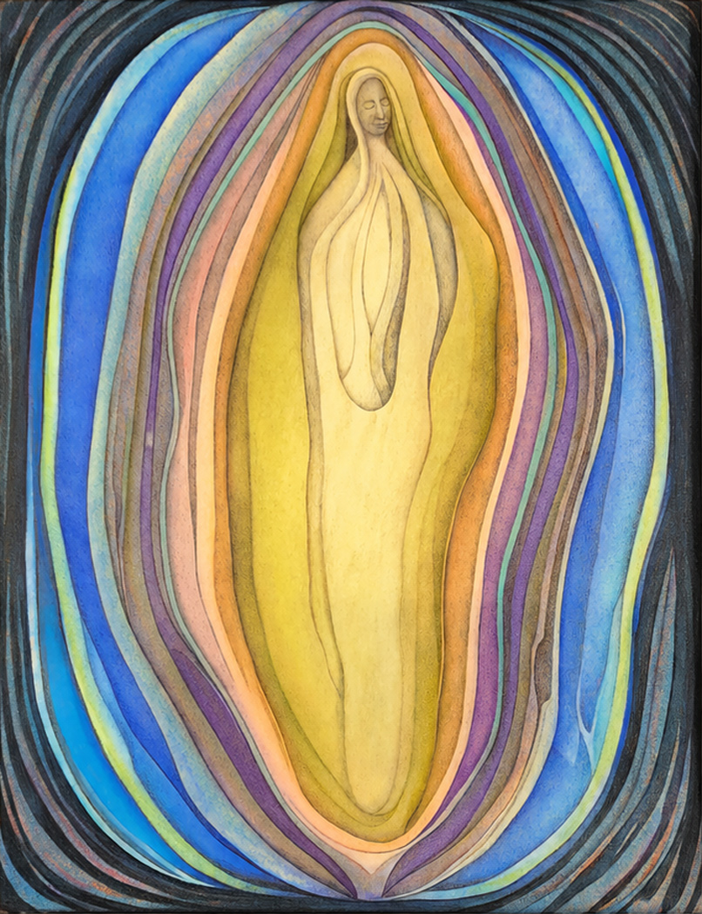

> claude, this is a content extraction of an image given to me by the site owner. I will put the original image here for reference.
> what follows after is a content extraction of the image. We need to figure out how to make this work on the web, since what I was given was a pdf for print
>

# APERTURE I
**PERMEABILITY**

*Behavior is the headwaters of coherence.*

Before concept, before ideology, before the architecture of understanding, coherence first becomes visible in the embodied behavior of the sovereign.

Permeability is the condition through which the sovereign intersects the Field without surrendering itself.

It is not collapse.  
It is not dissolution.  
It is the reduction of unnecessary interference.

The sovereign remains sovereign, yet relation becomes available. Within that availability, coherence begins to breathe.

*When permeability opens, relation becomes real.*  
*When relation becomes real, coherence becomes possible.*

---

**THIS IMAGE AS APERTURE I**

This is the sovereign in permeability.  
Not isolated.  
Not fused.  
But intersecting.

The form is not static; it is alive, layered, and breathing. Permeability is the movement that keeps the aperture open.

This image is not about becoming larger. It is about becoming more available— to relation, to the Field, to coherence itself.

*This is the first aperture. All others unfold within it.*

**INTERPRETATION**

The central figure is the sovereign—  
not as identity, but as presence.

The eyes are closed not in withdrawal,  
but in inward stability.  
Sovereignty is intact.

The concentric layers are permeable  
membranes of relation.  
Each color represents a different  
dimension of the Field.

Permeability is the dynamic by which  
these layers remain open, translucent,  
and mutually accessible.

**THE LAYERS**

(#f8df77) **Inner light / Essence**  
The sovereign's core presence.

(#f8cb88)**Embodiment**  
The lived, physical expression of presence.

(#b092b4)**Relational sensitivity**  
The capacity to feel without collapse.

(#9fc4af)**Interference reduction**  
The softening of distortion, defense, and reactivity.

(#496bae)**Field participation**  
Open engagement with the relational whole.

(#3e3f5b)**Transcendent context**  
The larger Field that contains and supports all.
